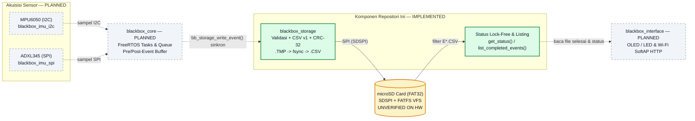
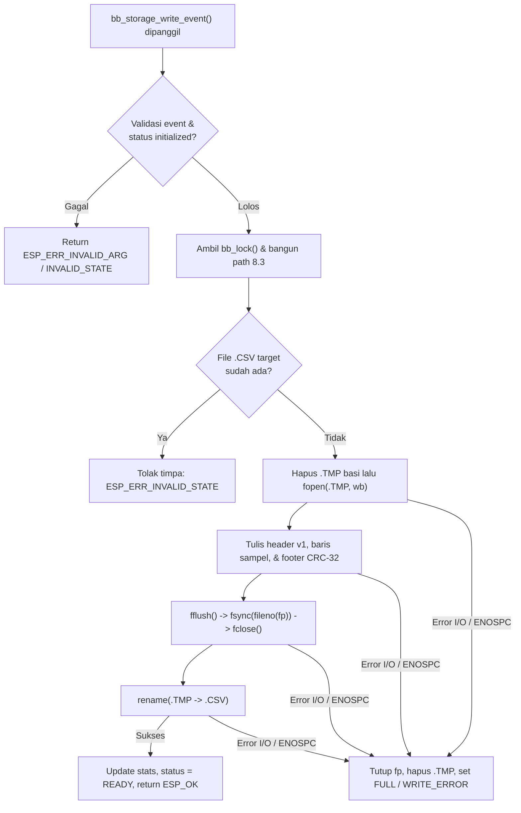

<div align="center">

<h1 align="center">Embedded Event Black Box</h1>

<p align="center"><strong>Subsistem Penyimpanan <code>blackbox_storage</code> &amp; Starter Firmware ESP32-S3 Berbasis ESP-IDF v5.4.4</strong></p>

[](sdkconfig.defaults)
[](CMakeLists.txt)
[](components/blackbox_storage/blackbox_storage.c)
[](components/blackbox_storage/CMakeLists.txt)
[](components/blackbox_storage/include/blackbox_storage.h)
[-15803D?style=flat-square)](evidence/build-and-test-log.txt)
[](tests/run_tests.ps1)
[](docs/07-HARDWARE-BRINGUP-CHECKLIST.md)

<p align="center"><em>Proyek kelompok mata kuliah <strong>Sistem Tertanam (Embedded Systems)</strong> untuk merekam data gerak berbasis pemicu (pre-event &amp; post-event) ke kartu microSD dengan integritas berkas terverifikasi CRC-32.</em></p>

[Team Handoff (`TEAM_HANDOFF.md`)](TEAM_HANDOFF.md) · [Status Proyek](#status-proyek) · [Arsitektur](#arsitektur-sistem) · [Bedah `blackbox_storage`](#bedah-komponen-blackbox_storage) · [API & Integrasi](#api-publik-dan-panduan-integrasi) · [Setup & Build](#memulai-di-windows-dengan-esp-idf-v544) · [Pengujian](#pengujian-dan-bukti-verifikasi) · [Dokumentasi](#dokumentasi-dan-sumber-belajar)

</div>

> **Anggota Tim / Integrator (`Core`, `ADXL345`, `Interface`, atau Ketua Tim)?**  
> Mulai dari [**`TEAM_HANDOFF.md`**](TEAM_HANDOFF.md) — pintu masuk utama serah terima komponen `blackbox_storage` yang merangkum apa yang sudah selesai, status verifikasi vs `UNVERIFIED ON HARDWARE`, file sumber yang perlu disalin, peta bacaan per peran, syarat integrasi antar-modul, dan langkah lanjutan tim.

> **Catatan Penting Ruang Lingkup & Keselamatan:**  
> 1. Proyek ini adalah **prototipe pembelajaran akademis**, bukan perekam kecelakaan kendaraan tersertifikasi keselamatan (*safety-certified crash recorder*).  
> 2. Repositori ini **berfokus pada komponen `blackbox_storage` dan aplikasi *starter* minimal (`main/main.c`)**, bukan sistem utuh 5 modul tim. Pengujian pada board fisik ESP32-S3 dan kartu microSD nyata masih berstatus **`UNVERIFIED ON HARDWARE`**.

---

## Daftar Isi

- [Ringkasan Proyek](#ringkasan-proyek)
- [Status Proyek](#status-proyek)
- [Fitur Utama](#fitur-utama)
- [Arsitektur Sistem](#arsitektur-sistem)
- [Perangkat Keras dan Stack Teknologi](#perangkat-keras-dan-stack-teknologi)
- [Bedah Komponen `blackbox_storage`](#bedah-komponen-blackbox_storage)
- [API Publik dan Panduan Integrasi](#api-publik-dan-panduan-integrasi)
- [Format Data dan Contoh CSV](#format-data-dan-contoh-csv)
- [Memulai di Windows dengan ESP-IDF v5.4.4](#memulai-di-windows-dengan-esp-idf-v544)
- [Pengujian dan Bukti Verifikasi](#pengujian-dan-bukti-verifikasi)
- [Struktur Proyek](#struktur-proyek)
- [Keputusan Desain Teknis](#keputusan-desain-teknis)
- [Batasan dan Catatan Keselamatan](#batasan-dan-catatan-keselamatan)
- [Peta Jalan Proyek](#peta-jalan-proyek)
- [Dokumentasi dan Sumber Belajar](#dokumentasi-dan-sumber-belajar)
- [Kredit dan Catatan Penutup](#kredit-dan-catatan-penutup)

---

## Ringkasan Proyek

### Apa itu Embedded Event Black Box?

**Embedded Event Black Box** adalah perangkat mikrokontroler yang memantau gerakan atau guncangan menggunakan sensor inersia (*accelerometer* dan *gyroscope*), lalu secara otomatis menyimpan rekaman data di sekitar momen kejadian ke kartu **microSD**. Konsepnya mirip kotak hitam (*flight data recorder*) sederhana untuk eksperimen dan pembelajaran sistem tertanam.

### Masalah yang Diselesaikan & Konsep Event-Based Recording

Menulis seluruh pembacaan sensor secara terus-menerus ke kartu microSD memboroskan kapasitas, mempercepat keausan sel memori flash, dan menyulitkan pencarian momen penting. Pendekatan **event-based recording** menyelesaikan masalah ini dengan cara:

1. Sensor dibaca secara periodik ke dalam penyangga sementara (*rolling buffer*) di RAM.
2. Saat guncangan melampaui ambang pemicu (*trigger*), sistem membekukan jendela rekaman yang mencakup sampel **sebelum kejadian (*pre-event*)**, titik **pemicu (*trigger*)**, dan sampel **sesudah kejadian (*post-event*)**.
3. Paket rekaman tersebut ditulis ke microSD sebagai berkas `.CSV` mandiri dengan penanda integritas **CRC-32**.

### Mengapa Memilih ESP32-S3?

**ESP32-S3** menyediakan prosesor dual-core dengan periferal terpisah (**I2C** dan beberapa pengendali **SPI** ber-DMA seperti `SPI2_HOST` dan `SPI3_HOST`), konektivitas **Wi-Fi** bawaan untuk akses nirkabel (*SoftAP + HTTP*), serta dukungan resmi framework **ESP-IDF** dan penjadwal *real-time* **FreeRTOS**.

### Visi Lengkap Tim vs Isi Repositori Saat Ini

Rancangan lengkap tim membagi sistem ke dalam **5 komponen reusable ESP-IDF**. Namun, agar pengembangan tetap terisolasi dan teruji, repositori ini **baru berisi implementasi penuh komponen Storage dan starter firmware minimal**:

| No | Komponen Tim | Tanggung Jawab Utama | Status di Repositori Ini |
|---|---|---|---|
| 1 | `blackbox_imu_i2c` | Akuisisi sensor MPU6050 (akselerometer + giroskop) via I2C | `PLANNED / PENDING INTEGRATION` |
| 2 | `blackbox_imu_spi` | Akuisisi sensor akselerometer ADXL345 via SPI | `PLANNED / PENDING INTEGRATION` |
| 3 | **`blackbox_storage`** | **Mount microSD (SDSPI + FATFS VFS), serialisasi CSV `v1`, siklus `.TMP` -> `.CSV`, verifikasi CRC-32, listing aman** | **`IMPLEMENTED` (Fokus Repositori Ini)** |
| 4 | `blackbox_interface` | Indikator lokal (OLED/LED), Wi-Fi SoftAP, & HTTP server untuk daftar/unduh file `.CSV` | `PLANNED / PENDING INTEGRATION` |
| 5 | `blackbox_core` | Orkestrasi task/queue FreeRTOS, *rolling buffer*, deteksi event, & *state machine* | `PLANNED / PENDING INTEGRATION` |

---

## Status Proyek

Verifikasi terkini tercatat pada [`evidence/build-and-test-log.txt`](evidence/build-and-test-log.txt) (`14 November 2026`, target `esp32s3`, **ESP-IDF v5.4.4**). Status perangkat lunak dan perangkat keras dibedakan secara tegas:

| Aspek Verifikasi | Label Status | Detail Faktual Terverifikasi |
|---|---|---|
| API & implementasi `blackbox_storage` | `IMPLEMENTED` | [`blackbox_storage.h`](components/blackbox_storage/include/blackbox_storage.h), [`blackbox_storage.c`](components/blackbox_storage/blackbox_storage.c), [`CMakeLists.txt`](components/blackbox_storage/CMakeLists.txt) |
| Unit, fault-injection & concurrency test (host) | `VERIFIED ON HOST` | **8/8 suite PASS** (`0 failed`) via [`tests/run_tests.ps1`](tests/run_tests.ps1) pada MinGW GCC `4.9.2` & MATLAB `lcc64` *(data simulasi host)* |
| Cross-compile objek target `esp32s3` | `VERIFIED ON HOST` | `blackbox_storage_esp32s3.o` (`148.936` B), `main_esp32s3.o` (`15.004` B) dengan `-Wall -Wextra -Werror` (`0 warnings`) |
| Full build firmware ESP-IDF (`idf.py build`) | `VERIFIED BY FULL FIRMWARE BUILD` | ESP-IDF `v5.4.4` (`esp32s3`, CMake `3.30.2`, Ninja `1.12.1`) sukses `0 warnings`: `embedded_blackbox.bin` (`205.056` B), `bootloader.bin` (`20.928` B), `partition-table.bin` (`3.072` B), `libblackbox_storage.a` (`189.180` B) |
| Starter `main/main.c` di board fisik | `NOT YET VERIFIED ON HARDWARE` | Menjalankan smoke test CSV in-memory lalu **sengaja keluar dini** karena pin SPI masih `GPIO_NUM_NC` (`-1`) |
| Mount, tulis, & baca kartu microSD fisik | `NOT YET VERIFIED ON HARDWARE` | Belum ada board ESP32-S3 terhubung, pin GPIO SPI belum final, & spesifikasi flash/PSRAM board belum dikonfirmasi |
| Integrasi sensor (`MPU6050`, `ADXL345`) | `PLANNED / PENDING INTEGRATION` | Driver sensor milik Anggota 1 & 2 belum berada di repositori ini |
| Integrasi `Core` & `Interface` (FreeRTOS/HTTP) | `PLANNED / PENDING INTEGRATION` | Menunggu komponen Anggota 4 & 5 serta sinkronisasi [`docs/02-KONTRAK-INTEGRASI.md`](docs/02-KONTRAK-INTEGRASI.md) |

> **Peringatan Penting:** Lulusnya `idf.py build` dan 8/8 *host test* membuktikan kebenaran sintaks, *linking* ESP-IDF, logika CSV/CRC-32, dan penanganan error di simulator host — **bukan** bukti bahwa pengkabelan fisik SPI, catu daya `3.3V`, atau kartu microSD nyata sudah berjalan di board ESP32-S3.

---

## Fitur Utama

### Kemampuan `blackbox_storage` (`IMPLEMENTED`)

- **Inisialisasi, Validasi Ketat & Teardown Aman:** Memvalidasi `host_id` (`SPI2_HOST`/`SPI3_HOST`), pin GPIO sah ESP32-S3, panjang `mount_point <= 13` karakter di ESP-IDF `v5.4.4`, me-rollback `spi_bus_free()` bila mount gagal, dan selalu membersihkan state lokal pada `bb_storage_deinit()`.
- **Fleksibilitas Kepemilikan Bus SPI (`manage_spi_bus`):** Mendukung bus SPI eksklusif (`true`) maupun berbagi satu bus dengan sensor ADXL345 (`false`) bila bus sudah diinisialisasi pemilik eksternal.
- **Proteksi Data Kartu SD (Anti-Auto-Format):** Parameter `format_if_mount_failed` dikunci `false`; konfigurasi `true` langsung ditolak (`ESP_ERR_INVALID_ARG`) agar kartu microSD tidak terhapus akibat kabel longgar.
- **Serialisasi CSV `v1` Terbatas & Deterministik:** Mengubah hingga `BB_STORAGE_MAX_SAMPLES` (`2048`) sampel *fixed-point* (`mg`, `mdps`) menjadi format CSV berversi tanpa risiko `float NaN/Inf`.
- **Siklus Berkas Dua Tahap (`.TMP` -> `.CSV`):** Menulis ke `E<7-hex>.TMP`, menjalankan `fflush()`, `fsync()`, dan `fclose()`, lalu `rename()` ke `E<7-hex>.CSV` serta menolak menimpa `event_id` yang sudah ada.
- **Verifikasi Integritas CRC-32 & Parser Ketat:** Menghitung **IEEE 802.3 CRC-32** di footer `# END_EVENT` dan memvalidasi baca-balik baris demi baris tanpa `sscanf` (`bb_storage_verify_event_file()`).
- **Listing Aman untuk HTTP Dashboard:** `bb_storage_list_completed_events()` dan `bb_storage_is_completed_event_filename()` menyaring `.TMP`, direktori palsu, dan berkas tes agar `blackbox_interface` hanya mengakses rekaman selesai.
- **Thread-Safe & Status Lock-Free:** Operasi I/O diproteksi mutex statis FreeRTOS (`xSemaphoreCreateMutexStatic`), sedangkan `bb_storage_get_status()` dibaca secara atomik (*lock-free*) agar UI tidak macet saat penulisan SD berlangsung.
- **Built-in Non-Destructive Self-Test:** `bb_storage_self_test()` menguji tulis, verifikasi CRC-32, dan hapus memakai berkas internal `BBTEST00.TMP`/`.CSV` tanpa menyentuh penghitung `events_written`.

### Fitur Sistem Lengkap Tim (`PLANNED / PENDING INTEGRATION`)

- Akuisisi sinkron dua sensor gerak pada bus berbeda (`MPU6050` via I2C dan `ADXL345` via SPI).
- *Rolling pre-event/post-event buffer*, deteksi benturan (*threshold* & konfirmasi silang), serta antrean penyimpanan FreeRTOS di `blackbox_core`.
- Antarmuka lokal OLED/LED dan server HTTP via Wi-Fi SoftAP untuk melihat status serta mengunduh berkas `.CSV` dari ponsel/laptop di `blackbox_interface`.

---

## Arsitektur Sistem

Diagram berikut membedakan secara jelas batas modul yang **sudah diimplementasikan** di repositori ini dengan modul tim yang **masih direncanakan**:



### Penjelasan Aliran Data & Pilihan Arsitektur

1. **Pemisahan Tugas Akuisisi vs Penulisan SD:** Penulisan kartu microSD lewat SPI bisa memakan waktu puluhan hingga ratusan milidetik (terutama saat kontroler flash internal kartu melakukan *housekeeping*). Karena itu, `blackbox_storage` **tidak** membaca sensor dan **tidak** dipanggil dari ISR atau task sampling 100 Hz; `blackbox_core` nantinya mengirim *snapshot* event melalui FreeRTOS Queue ke task penyimpan berprioritas lebih rendah.
2. **Isolasi Sebagai Komponen ESP-IDF:** `blackbox_storage` berdiri sebagai modul mandiri di [`components/blackbox_storage/`](components/blackbox_storage/README.md) tanpa bergantung pada driver sensor atau web server, sehingga dapat dikompilasi dan diuji terpisah lebih dulu.
3. **Batas Baca Aman untuk Interface:** `blackbox_interface` tidak membaca berkas `.TMP` yang sedang ditulis dan cukup memanggil API listing/status dari Storage untuk menyajikan berkas `.CSV` yang sudah tuntas.

---

## Perangkat Keras dan Stack Teknologi

| Teknologi / Perangkat | Peran dalam Sistem | Status Saat Ini |
|---|---|---|
| **ESP32-S3** | Mikrokontroler utama (`esp32s3`), CPU dual-core, I2C, `SPI2_HOST`/`SPI3_HOST` DMA, Wi-Fi | `VERIFIED BY FULL FIRMWARE BUILD` (fisik `NOT YET VERIFIED ON HARDWARE`) |
| **microSD (SDSPI)** | Media penyimpanan non-volatil berkas event berformat FAT16/FAT32 | Kode SDSPI `IMPLEMENTED`; fisik `NOT YET VERIFIED ON HARDWARE` |
| **ESP-IDF `v5.4.4`** | Framework resmi, build system CMake/Ninja, driver `sdspi_host`, `esp_vfs_fat`, `esp_driver_spi` | `VERIFIED BY FULL FIRMWARE BUILD` |
| **FreeRTOS** | Penjadwalan task, mutex statis internal Storage (`xSemaphoreCreateMutexStatic`), serta Queue/task Core | Mutex Storage `IMPLEMENTED`; integrasi task Core `PLANNED` |
| **MPU6050 (I2C)** | Sensor akselerometer & giroskop 6-axis via bus I2C (`blackbox_imu_i2c`) | `PLANNED / PENDING INTEGRATION` |
| **ADXL345 (SPI)** | Sensor akselerometer 3-axis via bus SPI (`blackbox_imu_spi`) | `PLANNED / PENDING INTEGRATION` |
| **OLED / LED & Wi-Fi SoftAP HTTP** | Tampilan status lokal & unduh berkas `.CSV` via web (`blackbox_interface`) | `PLANNED / PENDING INTEGRATION` |

### Konsep Penting untuk Pemula

- **SPI vs I2C:** **I2C** hanya memakai 2 jalur kabel (`SDA`, `SCL`) dengan pengalamatan perangkat lunak — hemat pin dan cocok untuk sensor seperti MPU6050. **SPI** memakai 4 jalur utama (`SCLK` detak clock, `MOSI` data keluar master, `MISO` data masuk master, `CS` pemilih perangkat) yang mendukung transfer kecepatan tinggi dan DMA untuk ADXL345 maupun microSD.
- **Mengapa microSD Memakai SDSPI:** Kartu microSD mendukung mode SDMMC native maupun mode **SDSPI** (perintah kartu SD dikirim di atas protokol SPI standar). Driver `sdspi_host` di ESP-IDF memungkinkan pin SPI ESP32-S3 dipetakan secara fleksibel melalui GPIO matrix.
- **Peran FATFS dan ESP-IDF VFS:** Kartu microSD mentah hanya berupa sektor-sektor 512 byte. **FatFs** mengelola struktur sistem berkas FAT16/FAT32 agar file dapat dibaca langsung di PC, sedangkan **ESP-IDF VFS (Virtual Filesystem)** memetakan partisi FatFs ke path seperti `/sdcard` sehingga kode C dapat menggunakan fungsi standar `fopen()`, `fputs()`, `fflush()`, `fsync()`, `fclose()`, dan `rename()`.
- **Mengapa FreeRTOS Penting:** Penjadwal *real-time* FreeRTOS memungkinkan task akuisisi sensor berprioritas tinggi tetap berjalan konsisten (mis. 100 Hz) sementara penulisan microSD yang lambat dan tak menentu dijalankan oleh task terpisah dengan proteksi *mutex*.
- **Kepemilikan & Berbagi Bus SPI (`SPI2_HOST` vs `SPI3_HOST`):** Jika microSD dan ADXL345 memakai host SPI terpisah (`manage_spi_bus = true`), I/O microSD tidak memblokir bus sensor. Jika keduanya berbagi satu bus SPI (`manage_spi_bus = false`), pemilik bus eksternal wajib mengaktifkan DMA (`max_transfer_sz >= 4000`), menahan semua pin **CS** tetap *HIGH* sebelum `bb_storage_init()`, dan menyediakan pull-up eksternal `3.3V` pada `SD_CS`.

> **Pemberitahuan Pinout & Spesifikasi Board:** Nomor pin GPIO fisik **sengaja tidak ditetapkan** di kode (disetel ke `GPIO_NUM_NC` / `-1`). Jangan mengasumsikan nomor pin dari contoh internet sebelum tim menyepakati varian board ESP32-S3, kapasitas flash/PSRAM, dan pemetaan pin `MOSI`/`MISO`/`SCLK`/`CS` di [`docs/07-HARDWARE-BRINGUP-CHECKLIST.md`](docs/07-HARDWARE-BRINGUP-CHECKLIST.md).

---

## Bedah Komponen `blackbox_storage`

Implementasi di [`components/blackbox_storage/blackbox_storage.c`](components/blackbox_storage/blackbox_storage.c) dirancang untuk menghadapi kondisi nyata kegagalan media SD dan akses konkuren antar-task.

### 1. Konfigurasi Publik & Validasi Awal

Struktur `bb_storage_config_t` (diinisialisasi aman lewat `BB_STORAGE_CONFIG_DEFAULT()`) mengatur `mount_point` (default `"/sdcard"`), `host_id` (`SPI2_HOST` atau `SPI3_HOST`), pin GPIO, `manage_spi_bus`, `format_if_mount_failed`, `max_open_files` (`1..16`, default `4`), dan `max_freq_khz` (`1..40000`, default `SDMMC_FREQ_DEFAULT` = `20000`).  
Saat `bb_storage_init()` dipanggil, fungsi `validate_config()` langsung menolak dengan `ESP_ERR_INVALID_ARG` apabila:
- `format_if_mount_failed == true` (kebijakan keamanan anti-hapus data),
- `host_id` bernilai `SPI1_HOST` (bus flash internal) atau di luar rentang,
- `gpio_cs` bernilai `GPIO_NUM_NC` atau bukan pin output sah ESP32-S3 (misal `22..25` atau `>= 49`),
- terdapat pin duplikat/kolisi dengan `gpio_cs`, atau `mount_point` melanggar aturan path (`<= 13` karakter di ESP-IDF `v5.4.4`, tanpa `..`, `//`, `\`, spasi, atau trailing `/`).

### 2. Inisialisasi Bus SPI & Mount FATFS dengan Rollback

Jika `manage_spi_bus == true`, `bb_storage_init()` memanggil `spi_bus_initialize()` dengan `SDSPI_DEFAULT_DMA` dan `max_transfer_sz = 4000`, lalu memanggil `esp_vfs_fat_sdspi_mount()` (`allocation_unit_size = 16 KB`). Jika mount gagal (misal kartu belum dipasang), bus SPI yang baru dibuat langsung dibebaskan lewat `spi_bus_free()` dan status disetel ke `BB_STORAGE_STATUS_MOUNT_FAILED`.

### 3. Validasi Event & Serialisasi CSV + CRC-32

`bb_storage_validate_event()` memastikan `format_version == 1`, `event_id` dalam `1 .. 0x0FFFFFFF`, `sample_count` dalam `1 .. 2048`, serta memeriksa overflow dengan syarat `pre_event_samples <= sample_count` dan `post_event_samples <= (sample_count - pre_event_samples)`.  
Checksum **IEEE 802.3 CRC-32** (`0xEDB88320`) dihitung oleh `bb_storage_compute_samples_crc32()` atas representasi biner *little-endian* ke-9 field tiap `bb_storage_sample_t` (37 byte per sampel).

### 4. Siklus Tulis Dua Tahap (`.TMP` -> `.CSV`)

Alur penulisan di dalam `bb_storage_write_event()` mencegah `blackbox_interface` membaca berkas yang belum tuntas:



Jika terjadi kegagalan pada langkah mana pun (`fopen`, `fputs`, `fflush`, `fsync`, `fclose`, atau `rename`), `errno` ditangkap sebelum logging (`ENOSPC` dipetakan ke `ESP_ERR_NO_MEM` dan status `BB_STORAGE_STATUS_FULL`; error lain ke `ESP_FAIL` dan `BB_STORAGE_STATUS_WRITE_ERROR`), `out_final_path[0]` dikosongkan, dan berkas `.TMP` segera dihapus. Penulisan berikutnya tetap diizinkan untuk memulihkan status kembali ke `READY`.

### 5. Verifikasi Ketat, Listing, Self-Test & Deinit

- **Verifikasi (`bb_storage_verify_event_file()`):** Memeriksa berkas baris demi baris (batas panjang baris 384 byte, mendukung LF & CRLF) memakai parser integer manual tanpa `sscanf`. Parser menolak kolom berlebih, indeks lompat, overflow `int32_t`/`uint64_t`, baris setelah `# END_EVENT`, atau selisih `CRC-32` (`ESP_ERR_INVALID_CRC`).
- **Listing (`bb_storage_list_completed_events()`):** Hanya meloloskan file reguler berpola tepat `E<7-hex-uppercase>.CSV` (`id != 0`), sehingga `.TMP`, direktori palsu, dan `BBTEST00.CSV` tersaring.
- **Self-Test (`bb_storage_self_test()`):** Memegang `bb_lock()`, menulis + memverifikasi + menghapus `BBTEST00.TMP`/`.CSV` (`event_id = BB_STORAGE_MAX_EVENT_ID`, flag `BB_EVENT_FLAG_SIMULATED`) tanpa mengubah `events_written`.
- **Deinit (`bb_storage_deinit()`):** Memanggil `esp_vfs_fat_sdcard_unmount()`, dan tetap mengosongkan `s_ctx.card`, mengubah status menjadi `BB_STORAGE_STATUS_UNINITIALIZED`, mereset kapasitas ke `0`, serta membebaskan bus SPI milik Storage walaupun `unmount()` mengembalikan error (mencegah *use-after-free*).

<details>
<summary><strong>Detail Internal ESP-IDF v5.4.4: Mutex Statis, Status Atomik & Catatan VFS/SDSPI</strong></summary>

1. **Mutex Statis & Status Lock-Free:** Mutex FreeRTOS dibuat lewat `xSemaphoreCreateMutexStatic(&s_ctx.mutex_buf)` di dalam `portENTER_CRITICAL(&s_mutex_init_spinlock)` tanpa alokasi heap dinamis. Sementara itu, `bb_storage_get_status()` membaca `s_ctx.status_atomic` melalui `__atomic_load_n(..., __ATOMIC_ACQUIRE)` sehingga loop LED/OLED/HTTP tidak tertahan saat I/O kartu SD berlangsung.
2. **Batas Panjang `mount_point`:** Pada `vfs_fat.c` ESP-IDF `v5.4.4`, `base_path` disalin dengan `strlcpy(..., sizeof(base_path) - 1)` di mana `ESP_VFS_PATH_MAX == 15`. Karena itu `blackbox_storage.c` membatasi `mount_point <= 13` karakter di target ESP-IDF agar lookup `esp_vfs_fat_info()` dan unmount tidak gagal akibat pemotongan string.
3. **Catatan `vfs_fat.c` & `sdspi_host.c`:** Pada ESP-IDF `v5.4.4`, cache internal `dir_path` dan `cached_fileinfo` di `vfs_fat_stat()`/`opendir()`/`readdir()` tidak diproteksi `fat_ctx->lock`, serta `sdspi_host.c` (`deinit_slot()`) mengembalikan pin `gpio_cs` ke mode input saat gagal mount atau `deinit`. Karena itu, `blackbox_interface` tidak boleh memanggil `opendir()`/`stat()` langsung saat writer aktif, dan bus berbagi dengan ADXL345 memerlukan resistor pull-up eksternal `3.3V` pada `SD_CS`.

</details>

---

## API Publik dan Panduan Integrasi

Seluruh kontrak publik didefinisikan di [`components/blackbox_storage/include/blackbox_storage.h`](components/blackbox_storage/include/blackbox_storage.h).

| Fungsi API | Pemanggil Utama | Kegunaan & Prasyarat | Nilai Balik Utama |
|---|---|---|---|
| `bb_storage_init(cfg)` | `Core` / `main` | Validasi pin & path, opsional init SPI bus, & mount FATFS | `ESP_OK`, `ESP_ERR_INVALID_ARG`, `ESP_ERR_INVALID_STATE`, `ESP_FAIL` |
| `bb_storage_deinit()` | `Core` / `main` | Unmount FATFS & bebas bus milik sendiri *(tutup semua `FILE*` dulu)* | `ESP_OK`, `ESP_ERR_INVALID_STATE`, `ESP_FAIL` |
| `bb_storage_get_status()` | `Interface` / `Core` | Baca status saat ini secara *lock-free/atomic* (non-blocking) | `bb_storage_status_t` |
| `bb_storage_status_to_str(st)` | `Interface` / `Core` | Konversi enum status ke string (`"READY"`, `"FULL"`, dll.) | `const char *` |
| `bb_storage_get_stats(out)` | `Interface` / `Core` | Snapshot statistik tulis & total/sisa kapasitas FAT *(hindari polling tiap detik)* | `ESP_OK`, `ESP_ERR_INVALID_ARG` |
| `bb_storage_validate_event(ev)` | `Core` / Internal | Validasi `format_version`, `event_id`, `sample_count`, & `pre+post` | `ESP_OK`, `ESP_ERR_INVALID_ARG`, `ESP_ERR_INVALID_SIZE` |
| `bb_storage_compute_samples_crc32(s, n)` | Internal / Test | Hitung IEEE 802.3 CRC-32 deterministik atas array sampel | `uint32_t` |
| `bb_storage_build_event_paths(...)` | Internal / `Interface` | Bentuk pasangan path 8.3 `<mount>/E<7-hex>.TMP` & `.CSV` | `ESP_OK`, `ESP_ERR_INVALID_ARG`, `ESP_ERR_INVALID_SIZE` |
| `bb_storage_format_event_csv(...)` | Test / Preview | Serialisasi `bb_event_record_t` menjadi teks CSV `v1` di buffer RAM | `ESP_OK`, `ESP_ERR_INVALID_ARG`, `ESP_ERR_INVALID_SIZE` |
| `bb_storage_write_event(ev, path, sz)` | `Core` (writer task) | Tulis `.TMP`, `fflush`+`fsync`+`fclose`, & `rename` ke `.CSV` secara sinkron | `ESP_OK`, `ESP_ERR_INVALID_ARG`/`SIZE`/`STATE`, `ESP_ERR_NO_MEM`, `ESP_FAIL` |
| `bb_storage_verify_event_file(...)` | `Core` / `Interface` / Test | Verifikasi struktur CSV `v1`, batas integer, jumlah baris, & CRC-32 | `ESP_OK`, `ESP_ERR_NOT_FOUND`, `ESP_ERR_INVALID_CRC`, `ESP_FAIL` |
| `bb_storage_list_completed_events(...)` | `Interface` / `Core` | Cacah/daftar nama file `E*.CSV` selesai *(urutan FAT belum tersortir)* | `ESP_OK`, `ESP_ERR_INVALID_ARG`, `ESP_ERR_INVALID_STATE`, `ESP_FAIL` |
| `bb_storage_is_completed_event_filename(f)` | `Interface` | Cek apakah basename berpola `E<7-hex-uppercase>.CSV` (`id != 0`) | `bool` (`true` / `false`) |
| `bb_storage_self_test()` | `Core` / Diagnostik | Uji tulis/verifikasi/hapus non-destruktif menggunakan `BBTEST00` | `ESP_OK` atau kode error |

### Kontrak Integrasi Penting (`Core` & `Interface`)

1. **Kepemilikan Memori & Konteks Task (`blackbox_core`):** `bb_storage_write_event()` bersifat **sinkron (blocking)** dan selesai membaca `event` beserta array `event->samples` sebelum fungsi *return*. Pemanggil tetap memiliki memori tersebut dan boleh langsung memakai ulang atau men-`free()`-nya setelah fungsi kembali. **Jangan** memanggilnya dari ISR atau task sensor 100 Hz; gunakan FreeRTOS Queue menuju task penyimpan dengan stack minimal `4096–6144` byte.
2. **Akses Aman Web Server (`blackbox_interface`):** Selalu periksa parameter nama file dengan `bb_storage_is_completed_event_filename()` (memblokir `.TMP` dan path traversal), batasi stream HTTP terbuka `<= cfg.max_open_files - 1`, gunakan `fopen()` lalu `fstat(fileno(fp), &st)` (jangan panggil `opendir()`/`stat()` langsung pada `/sdcard` saat writer aktif), dan tutup semua `FILE *` sebelum `bb_storage_deinit()`.
3. **Konfigurasi `sdkconfig.defaults` Proyek Utama:** Pastikan proyek gabungan menyertakan `CONFIG_FATFS_FS_LOCK=16` (default stok ESP-IDF adalah `0` yang menonaktifkan lock FatFs).

### Contoh Pemakaian Minimal

```c
/* Contoh integrasi pada writer task (pin GPIO wajib diisi pin board terverifikasi) */
bb_storage_config_t cfg = BB_STORAGE_CONFIG_DEFAULT();
cfg.host_id        = SPI2_HOST;
cfg.manage_spi_bus = true;   /* set false jika bus SPI sudah di-init Core bersama ADXL345 */
cfg.gpio_mosi      = BOARD_PIN_MOSI;
cfg.gpio_miso      = BOARD_PIN_MISO;
cfg.gpio_sclk      = BOARD_PIN_SCLK;
cfg.gpio_cs        = BOARD_PIN_SD_CS;

if (bb_storage_init(&cfg) == ESP_OK) {
    char saved_path[BB_STORAGE_MAX_PATH_LEN];
    esp_err_t err = bb_storage_write_event(&event_record, saved_path, sizeof(saved_path));
    if (err == ESP_OK) {
        /* saved_path berisi e.g. "/sdcard/E0000001.CSV"; buffer event_record boleh dipakai ulang */
    }
}

/* Contoh di blackbox_interface: cek jumlah lalu ambil daftar file selesai */
size_t total = 0U;
if (bb_storage_get_status() == BB_STORAGE_STATUS_READY &&
    bb_storage_list_completed_events(NULL, 0U, &total) == ESP_OK && total > 0U) {
    char files[16][BB_STORAGE_MAX_FILENAME_LEN];
    size_t count = 0U;
    (void)bb_storage_list_completed_events(files, 16U, &count);
}
```

---

## Format Data dan Contoh CSV

Setiap rekaman memakai konvensi nama berkas **8.3 FAT-compliant** agar tetap kompatibel meski Long File Names dinonaktifkan:
- Berkas sementara selama penulisan: `E<7-digit-hex-uppercase>.TMP` (contoh: `/sdcard/E0000001.TMP`)
- Berkas terfinalisasi: `E<7-digit-hex-uppercase>.CSV` (contoh: `/sdcard/E0000001.CSV`, mendukung `event_id` `1` s.d. `0x0FFFFFFF`)

### Satuan & Struktur Kolom

- **Metadata Header (8 baris `# `):** memuat versi format (`v1`), `event_id`, `trigger_timestamp_us`, `sample_rate_hz`, `flags` (bitmask `bb_event_flags_t`), `pre_event_samples`, `post_event_samples`, dan `sample_count`.
- **Kolom Data (`10` kolom):** `sample_idx,timestamp_us,offset_ms,sensor,ax_mg,ay_mg,az_mg,gx_mdps,gy_mdps,gz_mdps`
  - `offset_ms`: waktu relatif terhadap pemicu (`< 0` sebelum kejadian, `0` titik trigger, `> 0` sesudah kejadian).
  - `sensor`: `1` = `BB_SENSOR_MPU6050_I2C`, `2` = `BB_SENSOR_ADXL345_SPI` *(kontrak provisional)*.
  - `ax_mg..az_mg`: akselerasi dalam **milli-g (`mg`)**, di mana `1000 mg = 1.0 g`.
  - `gx_mdps..gz_mdps`: kecepatan sudut dalam **milli-derajat per detik (`mdps`)**, di mana `1000 mdps = 1.0 deg/s` (`0` untuk sensor tanpa giroskop seperti ADXL345).
- **Footer Integritas:** `# END_EVENT,count=<N>,crc32=0x<8-HEX>`.

### Contoh Berkas Terverifikasi (DATA SIMULASI SINTETIS)

Kutipan berikut berasal langsung dari [`evidence/example-event-simulated.csv`](evidence/example-event-simulated.csv) (`441` bytes, 4 sampel sintetis — **BUKAN** data sensor perangkat keras nyata):

```csv
# BLACKBOX_EVENT_FORMAT,v1
# event_id,1
# trigger_timestamp_us,5020000
# sample_rate_hz,100
# flags,0x00000087
# pre_event_samples,2
# post_event_samples,1
# sample_count,4
sample_idx,timestamp_us,offset_ms,sensor,ax_mg,ay_mg,az_mg,gx_mdps,gy_mdps,gz_mdps
0,5000000,-20,1,10,-15,998,100,-30,10
1,5010000,-10,2,18,-22,1004,0,0,0
2,5020000,0,1,2940,-510,1250,1450,320,-90
3,5030000,10,2,410,-95,1015,0,0,0
# END_EVENT,count=4,crc32=0x10BF5ABE
```

**Mengapa CSV + CRC-32?** Format teks CSV dapat langsung dibuka di Excel, MATLAB, atau Python tanpa alat dekode tambahan. Pada contoh di atas, `flags=0x00000087` menandakan data simulasi terkonfirmasi silang (`TRIG_I2C | TRIG_SPI | CROSS_CONFIRMED | SIMULATED`), sementara `offset_ms` (`-20`, `-10`, `0`, `10`) memetakan posisi sampel sebelum, tepat pada, dan sesudah trigger. Footer **CRC-32 (IEEE 802.3)** mendeteksi korupsi bit tidak sengaja atau berkas terpotong (*truncation*), namun bukan mekanisme otentikasi kriptografis.

---

## Memulai di Windows dengan ESP-IDF v5.4.4

### Prasyarat Lingkungan

- **Editor:** VS Code + Ekstensi **Espressif ESP-IDF**
- **Framework:** **ESP-IDF v5.4.4** (termasuk `idf.py`, CMake `3.30.2`, Ninja `1.12.1`, Python venv, dan toolchain `xtensa-esp32s3-elf-gcc`)
- **Target Chip:** `esp32s3`

> **Penting:** Di VS Code atau terminal PowerShell, selalu buka **direktori root proyek ESP-IDF** (folder yang langsung memuat `CMakeLists.txt` dan `sdkconfig.defaults`), **bukan** folder induknya.

### Langkah Konfigurasi & Build (Tanpa Memerlukan Board Fisik)

Buka **ESP-IDF 5.4.4 PowerShell** (atau terminal ESP-IDF di VS Code), lalu jalankan:

```powershell
idf.py --version
cmake --version
ninja --version
idf.py set-target esp32s3
idf.py build
```

> **Catatan `set-target`:** Perintah `idf.py set-target esp32s3` umumnya hanya dijalankan **satu kali** saat setup awal proyek (atau jika ingin mengganti target chip), bukan sebelum setiap *incremental build*.

Setelah selesai tanpa error, artefak firmware ESP32-S3 dihasilkan di dalam folder lokal `build/` (terkecuali dari Git):
- `build/embedded_blackbox.bin` & `build/embedded_blackbox.elf`
- `build/bootloader/bootloader.bin`
- `build/partition_table/partition-table.bin`

> **Jangan Jalankan `idf.py flash` Sebelum Hardware Siap:**  
> Pin SPI di [`main/main.c`](main/main.c) sengaja disetel ke `GPIO_NUM_NC` (`-1`), dan [`sdkconfig.defaults`](sdkconfig.defaults) memakai default Flash **2 MB DIO / 80 MHz** tanpa PSRAM dan partisi **Single factory app (`1M`)**. Pastikan pinout SPI, tegangan `3.3V`, ukuran Flash, mode SPI Flash, dan PSRAM board fisik sesuai dengan [`docs/07-HARDWARE-BRINGUP-CHECKLIST.md`](docs/07-HARDWARE-BRINGUP-CHECKLIST.md) sebelum melakukan flashing.

<details>
<summary><strong>Troubleshooting Umum ESP-IDF di Windows</strong></summary>

| Masalah | Penyebab Umum | Solusi Cepat |
|---|---|---|
| `idf.py` tidak dikenali | Menjalankan perintah di PowerShell Windows biasa tanpa aktivasi ESP-IDF | Gunakan *ESP-IDF 5.4.4 PowerShell* atau terminal Ekstensi ESP-IDF di VS Code; atau aktifkan profil aktivasi lokal (contoh instalasi lokal: `C:\Espressif\v5.4.4\esp-idf` / `Microsoft.v5.4.4.PowerShell_profile.ps1`) |
| `cmake` tidak dikenali | Direktori `cmake\3.30.2\bin` milik ESP-IDF belum masuk `PATH` sesi terminal | Jalankan dari terminal ESP-IDF resmi atau tambahkan folder `bin` CMake instalasi ESP-IDF ke `PATH` sesi |
| Error `CMakeLists.txt not found` | Terminal berada di folder induk, bukan folder root proyek | `cd` ke folder yang berisi `CMakeLists.txt` dan `sdkconfig.defaults` |
| Target bukan `esp32s3` | `sdkconfig` lama menargetkan chip lain | Jalankan `idf.py set-target esp32s3` satu kali sebelum `idf.py build` |
| Python / toolchain gagal | Virtual environment Python ESP-IDF tidak aktif | Pastikan menggunakan Python venv bawaan ESP-IDF `v5.4.4`, bukan Python sistem terpisah |

</details>

---

## Pengujian dan Bukti Verifikasi

Suite pengujian otomatis host dan cross-compile cepat dapat dijalankan kapan saja melalui PowerShell di root proyek:

```powershell
powershell -NoProfile -ExecutionPolicy Bypass -File .\tests\run_tests.ps1
```

| Tingkat Pengujian | Alat / Perintah | Yang Diverifikasi | Keterbatasan / Status |
|---|---|---|---|
| **1. Cross-Compile Target `esp32s3`** | `run_tests.ps1` Step 1 (`xtensa-esp32s3-elf-gcc` `-Wall -Wextra -Werror`) | Kompilasi `blackbox_storage.c` & `main.c` terhadap header SDK ESP-IDF `v5.4` | **PASS (`0 warnings`)** — hanya memeriksa kompilasi `.o`, bukan link penuh |
| **2. Host Simulation Unit Tests** | `run_tests.ps1` Step 2 (`MinGW GCC 4.9.2 -std=gnu11` & `MATLAB lcc64`) | 8 suite: validasi pin/config, lifecycle & rollback mount/unmount, overflow guard, path 8.3, CSV `v1` + CRC `0x10BF5ABE`, 2048 sampel & korupsi CSV, 11 titik *fault injection* (`ENOSPC`/`EIO`/fsync/rename), listing, `BBTEST00` self-test, & konkurensi 4 thread Win32 | **PASS (`8/8` di kedua compiler)** — memakai stub host (`BB_STORAGE_HOST_TEST`), **bukan** FreeRTOS atau kartu SD fisik |
| **3. Full ESP-IDF Firmware Build** | `idf.py build` & `idf.py size` (ESP-IDF `v5.4.4`) | Linking seluruh komponen ESP-IDF menghasilkan `.elf`, `.bin`, bootloader, & partition table | **PASS (`0 warnings`)** — lihat ukuran artefak di log bukti *(starter ELF hanya menautkan `1.186` B dari archive karena keluar dini di `GPIO_NUM_NC`)* |
| **4. Uji Hardware Fisik microSD** | `idf.py flash monitor` + modul microSD 3.3V | Inisialisasi kartu fisik, integritas sinyal SPI, latensi tulis nyata, konsumsi arus, & kasus cabut kartu | **`NOT RUN / UNVERIFIED ON HARDWARE`** |

Seluruh log mentah dari eksekusi aktual terdokumentasi di [`evidence/build-and-test-log.txt`](evidence/build-and-test-log.txt) dan [`docs/03-PENGUJIAN-DAN-BUKTI.md`](docs/03-PENGUJIAN-DAN-BUKTI.md).

---

## Struktur Proyek

```text
embedded-blackbox-storage-starter/
├── .github/
│   └── pull_request_template.md          # Template PR dengan checklist bukti & risiko integrasi
├── .gitignore                            # Mengecualikan build/, sdkconfig, .vscode/, binary & file sensitif
├── AGENTS.md                             # Aturan kerja & batas lingkup untuk asisten pengkodean
├── CMakeLists.txt                        # Root proyek ESP-IDF (embedded_blackbox)
├── README.md                             # Dokumentasi utama proyek (berkas ini)
├── START_HERE.md                         # Panduan orientasi cepat pengembang Storage
├── TEAM_HANDOFF.md                       # Pintu masuk utama onboarding & serah terima untuk tim
├── sdkconfig.defaults                    # Konfigurasi default target esp32s3, FATFS_FS_LOCK=16, stack 6144
├── main/
│   ├── CMakeLists.txt                    # Registrasi komponen main (REQUIRES blackbox_storage)
│   └── main.c                            # Starter smoke test CSV sintetis & guard GPIO_NUM_NC
├── components/
│   └── blackbox_storage/
│       ├── CMakeLists.txt                # Registrasi komponen reusable ESP-IDF
│       ├── README.md                     # Dokumentasi teknis & provenance lisensi komponen Storage
│       ├── blackbox_storage.c            # Implementasi SDSPI, FATFS VFS, CSV v1, CRC-32 & mutex
│       └── include/
│           └── blackbox_storage.h        # Kontrak API publik, struct data, & konstanta batas
├── tests/
│   ├── run_tests.ps1                     # Runner cross-compile esp32s3 + unit test host (GCC & lcc64)
│   └── test_blackbox_storage_host.c      # 8 suite unit, fault-injection, CSV corruption & concurrency test
├── evidence/
│   ├── build-and-test-log.txt            # Log aktual run_tests.ps1 & idf.py build/size ESP-IDF v5.4.4
│   └── example-event-simulated.csv       # Contoh keluaran CSV v1 simulasi (441 B, CRC 0x10BF5ABE)
├── docs/
│   ├── 00-PETA-KONTEKS.md                # Pemetaan instruksi dosen vs brief rancangan tim
│   ├── 01-STORAGE-TUGAS-GUE.md           # Scope, milestone S0-S4, & status komponen Storage
│   ├── 02-KONTRAK-INTEGRASI.md           # Kontrak API bersama Core, ADXL345, & Interface
│   ├── 03-PENGUJIAN-DAN-BUKTI.md         # Matriks rencana uji T0-T10 & bukti terukur
│   ├── 04-HANDOFF-PRESENTASI.md          # Panduan integrasi tim & naskah presentasi
│   ├── 05-KEPUTUSAN-DAN-PERTANYAAN.md    # Log keputusan teknis & pertanyaan terbuka untuk tim
│   ├── 06-BELAJAR-STORAGE.md             # Modul belajar bertahap SPI, SDSPI, FATFS, & FreeRTOS
│   └── 07-HARDWARE-BRINGUP-CHECKLIST.md  # Checklist keselamatan kelistrikan 3.3V & bring-up microSD
├── prompts/
│   └── ANTIGRAVITY-STORAGE-MASTER.md     # Prompt acuan pengembangan komponen Storage
└── source_refs/
    └── README.md                         # Daftar tautan referensi resmi Espressif ESP-IDF v5.4
```

> *Catatan:* Direktori `build/`, berkas `sdkconfig` hasil generate lokal, dan `.vscode/` dikecualikan melalui [`.gitignore`](.gitignore) agar tidak ikut ter-commit.

---

## Keputusan Desain Teknis

| Keputusan Desain | Pilihan yang Diambil | Alasan & Pertimbangan Teknis |
|---|---|---|
| **Struktur Kode** | Komponen reusable `components/blackbox_storage/` | Memudahkan tim lain menambahkan `REQUIRES blackbox_storage` tanpa bentrok dengan `main/` |
| **Filesystem** | FATFS via ESP-IDF VFS (`esp_vfs_fat_sdspi_mount`) | Berkas langsung kompatibel dengan PC/Windows/Linux serta dapat diakses via fungsi C `stdio` |
| **Format Rekaman** | CSV teks `v1` dengan integer `mg` & `mdps` | Mudah diperiksa manusia saat demo/debugging dan bebas inkonsistensi format *floating-point* |
| **Integritas Data** | IEEE 802.3 CRC-32 atas nilai biner sampel (`# END_EVENT`) | Deterministik di host maupun ESP32-S3; mendeteksi file terpotong atau mutasi data |
| **Anti-Partial Read** | Tulis ke `.TMP` -> `fflush`/`fsync`/`fclose` -> `rename` `.CSV` | Mencegah HTTP server (`Interface`) mengunduh file separuh sebelum penulisan selesai |
| **Model Eksekusi** | API `bb_storage_write_event()` sinkron tanpa task internal | Kebijakan penjadwalan & antrean tetap di tangan `blackbox_core` tanpa task tersembunyi |
| **Bus SPI** | Opsi `SPI2_HOST` / `SPI3_HOST` lewat `manage_spi_bus` | Mendukung bus terpisah *(disarankan)* maupun berbagi satu bus dengan ADXL345 |
| **Batas Memori & Threading** | Maks `2048` sampel/event & mutex statis (`xSemaphoreCreateMutexStatic`) | Mencegah penulisan tak terbatas serta menghilangkan alokasi heap untuk primitif sinkronisasi |

---

## Batasan dan Catatan Keselamatan

1. **Belum Diuji di Hardware Fisik (`UNVERIFIED ON HARDWARE`):** Kestabilan sinyal SPI pada kabel jumper, kompatibilitas kartu SD spesifik, lonjakan arus tulis, dan waktu latensi nyata belum diukur di board ESP32-S3.
2. **Pin GPIO & Spesifikasi Board Belum Final:** Pin SPI starter masih `GPIO_NUM_NC` (`-1`), dan `sdkconfig.defaults` memakai default `2MB DIO` tanpa PSRAM. Sesuaikan seluruhnya dengan hardware nyata sebelum flashing.
3. **Risiko Mati Listrik Mendadak pada FAT32:** Siklus `.TMP -> fsync -> rename .CSV` mencegah pembacaan berkas parsial pada kondisi normal, namun sistem berkas FAT16/FAT32 **tidak** bersifat *power-loss atomic* pada level tabel alokasi cluster FAT bila daya terputus tepat saat penulisan sektor metadata FAT.
4. **Operasi I/O Blocking:** `bb_storage_write_event()` memblokir task pemanggil selama transfer SPI. Selain itu, `bb_storage_get_stats()` memanggil `esp_vfs_fat_info()` (`f_getfree()`) yang pada kartu tanpa `FSInfo` valid dapat memindai FAT selama beberapa detik sambil memegang `bb_lock()` — jangan dipanggil secara berkala tiap detik.
5. **Konkurensi `vfs_fat.c` & Integrasi `Interface`:** Pastikan `CONFIG_FATFS_FS_LOCK=16` aktif, hindari `opendir()`/`stat()` langsung dari `blackbox_interface` saat writer aktif (gunakan `bb_storage_list_completed_events()` + `fopen` + `fstat`), dan tutup semua stream sebelum `bb_storage_deinit()`.
6. **Kebijakan Larangan Auto-Format:** `format_if_mount_failed` wajib `false` agar kabel longgar atau kontak socket tidak pernah memicu pemformatan kartu microSD otomatis.
7. **Starter Entry Point:** Jangan menyalin [`main/main.c`](main/main.c) ke repositori gabungan tim; integrasikan hanya direktori [`components/blackbox_storage/`](components/blackbox_storage/README.md).

---

## Peta Jalan Proyek

- [x] Perancangan API publik & kontrak integrasi (`blackbox_storage.h`, `docs/02-KONTRAK-INTEGRASI.md`)
- [x] Implementasi & hardening `blackbox_storage` (SDSPI/FATFS, CSV `v1`, `.TMP -> .CSV`, CRC-32, parser ketat, mutex statis)
- [x] Verifikasi cross-compile objek `esp32s3` & **8/8 host regression test** (`tests/run_tests.ps1`)
- [x] Verifikasi **full build ESP-IDF `v5.4.4`** target `esp32s3` (`0 warnings`)
- [ ] Konfirmasi varian board ESP32-S3, pinout GPIO SPI, spesifikasi Flash/PSRAM, & kepemilikan bus SPI tim
- [ ] Hardware bring-up fisik & pengujian mount/tulis/baca/cabut kartu microSD sesuai [`docs/07-HARDWARE-BRINGUP-CHECKLIST.md`](docs/07-HARDWARE-BRINGUP-CHECKLIST.md)
- [ ] Integrasi `blackbox_core` (rolling pre/post-event buffer & FreeRTOS writer task)
- [ ] Integrasi sensor (`blackbox_imu_i2c`, `blackbox_imu_spi`) & antarmuka (`blackbox_interface`)
- [ ] Uji sistem *end-to-end* serta pengukuran latensi dan *stack high-water mark* di perangkat keras nyata

---

## Dokumentasi dan Sumber Belajar

| Dokumen | Sasaran Pembaca | Ringkasan Isi |
|---|---|---|
| [`TEAM_HANDOFF.md`](TEAM_HANDOFF.md) | **Seluruh anggota tim** (`Core`, `SPI`, `Interface`, Ketua) | **Pintu masuk utama serah terima:** status, file integrasi, peta bacaan per peran, syarat modul, & langkah lanjutan |
| [`START_HERE.md`](START_HERE.md) | Pemilik komponen & kontributor baru | Urutan langkah mempelajari repositori & aturan Git lokal |
| [`docs/06-BELAJAR-STORAGE.md`](docs/06-BELAJAR-STORAGE.md) | **Pemula / Presentasi Mahasiswa** | Penjelasan ramah pemula: SPI, SDSPI, FATFS, VFS, `.TMP -> .CSV`, & FreeRTOS |
| [`components/blackbox_storage/README.md`](components/blackbox_storage/README.md) | Pengembang komponen | Ringkasan API publik, skema CSV `v1`, provenance upstream, & batasan teknis |
| [`docs/02-KONTRAK-INTEGRASI.md`](docs/02-KONTRAK-INTEGRASI.md) | Tim `Core`, `ADXL345`, & `Interface` | Kontrak struktur data, kepemilikan buffer, bus SPI, & aturan konkurensi VFS |
| [`docs/05-KEPUTUSAN-DAN-PERTANYAAN.md`](docs/05-KEPUTUSAN-DAN-PERTANYAAN.md) | Ketua tim & semua anggota | Log keputusan teknis & pertanyaan integrasi yang menunggu kesepakatan tim |
| [`docs/07-HARDWARE-BRINGUP-CHECKLIST.md`](docs/07-HARDWARE-BRINGUP-CHECKLIST.md) | Penguji hardware tim | Daftar periksa kelistrikan 3.3V, pemilihan GPIO ESP32-S3, & uji fisik bertahap |
| [`docs/03-PENGUJIAN-DAN-BUKTI.md`](docs/03-PENGUJIAN-DAN-BUKTI.md) | Dosen / Penilai / Reviewer | Tabel kasus uji `T0–T10`, metrik terukur, & rujukan log bukti |
| [`docs/04-HANDOFF-PRESENTASI.md`](docs/04-HANDOFF-PRESENTASI.md) | Ketua tim / Presenter | Langkah pasang komponen ke proyek utama, skrip presentasi, & tanya-jawab |
| [`docs/01-STORAGE-TUGAS-GUE.md`](docs/01-STORAGE-TUGAS-GUE.md) | Pemilik modul Storage | Status milestone `S0–S4` & rincian kasus gagal yang ditangani |
| [`docs/00-PETA-KONTEKS.md`](docs/00-PETA-KONTEKS.md) | Semua pihak / Reviewer | Pemisahan konteks instruksi dosen vs rancangan brief kelompok |
| [`source_refs/README.md`](source_refs/README.md) | Pengembang | Tautan referensi resmi Espressif ESP-IDF `v5.4` untuk target `esp32s3` |

**Urutan Baca yang Disarankan untuk Pemula:**  
[`START_HERE.md`](START_HERE.md) → [`docs/06-BELAJAR-STORAGE.md`](docs/06-BELAJAR-STORAGE.md) → [`components/blackbox_storage/README.md`](components/blackbox_storage/README.md) → [`docs/02-KONTRAK-INTEGRASI.md`](docs/02-KONTRAK-INTEGRASI.md) → [`docs/07-HARDWARE-BRINGUP-CHECKLIST.md`](docs/07-HARDWARE-BRINGUP-CHECKLIST.md).

---

## Kredit dan Catatan Penutup

Proyek ini disusun sebagai tugas kelompok akademik mata kuliah **Sistem Tertanam (Embedded Systems)** oleh **Embedded Event Black Box Team (UNPAD)**.

- **Lisensi Kode Proyek:** Header berkas sumber pada repositori ini mencantumkan `SPDX-License-Identifier: MIT`.
- **Referensi Upstream:** Desain driver mengacu pada dokumentasi dan contoh resmi Espressif **ESP-IDF v5.4 / v5.4.4** untuk `esp32s3` (*FATFS VFS API* / `sdspi_host` berlisensi **Apache-2.0**, serta contoh `examples/storage/sd_card/sdspi` berlisensi **Public Domain / CC0-1.0**) sebagaimana dicatat pada [`components/blackbox_storage/README.md`](components/blackbox_storage/README.md).

---

<div align="center">

<p align="center"><strong>Embedded Event Black Box · Komponen <code>blackbox_storage</code> (ESP32-S3 / ESP-IDF v5.4.4)</strong><br/>
<em>Dibangun dengan kejujuran verifikasi: Teruji di Host &amp; Full Firmware Build — Menunggu Pengujian Hardware Fisik.</em></p>

</div>
