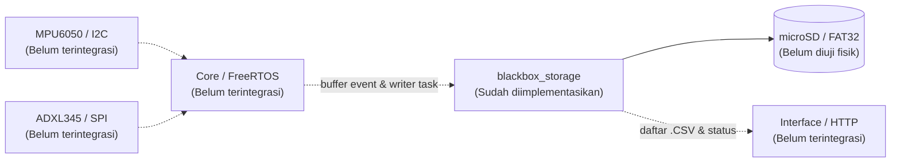

<div align="center">

# Panduan Serah Terima untuk Tim

### Embedded Event Black Box — Komponen `blackbox_storage`

**ESP32-S3 · ESP-IDF v5.4.4 · SDSPI · FATFS/VFS · CSV v1 · CRC-32**

*Mulai dari sini jika kamu anggota kelompok yang baru membuka repository ini atau ingin mengintegrasikan Storage ke firmware utama.*

</div>

> **Snapshot progres: 14 November 2026 · branch `feat/blackbox-storage-hardening`.**
> Status harus diperbarui setelah integrasi atau pengujian hardware berikutnya. Dokumen ini menjelaskan **komponen Storage**, bukan mengklaim seluruh sistem lima modul sudah berfungsi.

---

## 1. Status Singkat: Selesai, Terverifikasi, dan Belum Diuji

Di repository ini telah disiapkan komponen ESP-IDF reusable **`blackbox_storage`** beserta *starter* verifikasi, suite uji otomatis, bukti log build/test, dan dokumentasi integrasi. Storage bertugas menerima rekaman event dari Core dan menyimpannya ke microSD melalui **SDSPI + FATFS/VFS**.

### A. Yang Sudah Selesai di `blackbox_storage`

- **Mount & lifecycle SPI aman:** `bb_storage_init()` / `bb_storage_deinit()` memvalidasi `host_id` (`SPI2_HOST`/`SPI3_HOST`), pin GPIO ESP32-S3, dan batas `mount_point <= 13` karakter (`ESP_VFS_PATH_MAX - 2` pada ESP-IDF v5.4.4); mendukung bus mandiri atau berbagi (`manage_spi_bus`), *rollback* `spi_bus_free()` jika mount gagal, serta pembersihan state/bus pada `deinit`.
- **Anti-auto-format:** `format_if_mount_failed` dikunci `false` (`true` ditolak dengan `ESP_ERR_INVALID_ARG`).
- **Format CSV `v1` & CRC-32:** serialisasi hingga `BB_STORAGE_MAX_SAMPLES` (`2048`) sampel *fixed-point* (`mg`, `mdps`) ke nama berkas 8.3 (`E<7-hex>.TMP` -> `.CSV`) lengkap dengan checksum **IEEE 802.3 CRC-32** di footer `# END_EVENT`.
- **Siklus tulis dua tahap & pemulihan error:** menulis ke `.TMP`, menjalankan `fflush()` + `fsync()` + `fclose()`, lalu `rename()` ke `.CSV`; menolak menimpa `event_id` yang sudah ada (`ESP_ERR_INVALID_STATE`); menghapus `.TMP` dan memetakan `ENOSPC` (`FULL`) / I/O error (`WRITE_ERROR`) jika gagal.
- **Verifikasi, listing aman, self-test & thread-safety:** parser ketat tanpa `sscanf` (`bb_storage_verify_event_file()`), filter berkas selesai (`bb_storage_list_completed_events()`, `bb_storage_is_completed_event_filename()`), self-test non-destruktif (`BBTEST00`), mutex FreeRTOS statis, dan status atomik *lock-free* (`bb_storage_get_status()`).

### B. Ringkasan Verifikasi vs Status Hardware

| Area | Status | Ringkasan Bukti / Catatan Jujur | Rujukan |
|---|---|---|---|
| Implementasi komponen `blackbox_storage` | **SELESAI** | Header publik, implementasi C, konfigurasi CMake, & dokumentasi komponen | [`blackbox_storage.h`](components/blackbox_storage/include/blackbox_storage.h), [`blackbox_storage.c`](components/blackbox_storage/blackbox_storage.c) |
| Cross-compile objek `esp32s3` | **PASS (0 warnings)** | `xtensa-esp-elf-gcc` 14.2.0 (`-Wall -Wextra -Werror`) terhadap header SDK ESP-IDF v5.4 | [`tests/run_tests.ps1`](tests/run_tests.ps1), [`evidence/build-and-test-log.txt`](evidence/build-and-test-log.txt) |
| Host unit, fault-injection & concurrency tests | **PASS (8/8 suite)** | Lulus di **MinGW GCC 4.9.2** & **MATLAB `lcc64`**: validasi pin/config, rollback lifecycle, CSV `v1` + golden CRC `0x10BF5ABE` (`441` B), 2048 sampel & korupsi CSV, 11 titik fault (`ENOSPC`/IO/`fsync`/rename), filter listing/`BBTEST00`, & 4 thread paralel *(memakai stub host, bukan FreeRTOS/SD nyata)* | [`tests/test_blackbox_storage_host.c`](tests/test_blackbox_storage_host.c), [`evidence/example-event-simulated.csv`](evidence/example-event-simulated.csv) |
| Full firmware build (`idf.py build`, target `esp32s3`) | **PASS (ESP-IDF v5.4.4)** | Sukses `0 warnings/errors` (CMake `3.30.2`, Ninja `1.12.1`): `embedded_blackbox.bin` (`205.056` B), `bootloader.bin` (`20.928` B), `partition-table.bin` (`3.072` B), `libblackbox_storage.a` (`189.180` B) | [`evidence/build-and-test-log.txt`](evidence/build-and-test-log.txt), [`docs/03-PENGUJIAN-DAN-BUKTI.md`](docs/03-PENGUJIAN-DAN-BUKTI.md) |
| Mount/baca/tulis microSD di ESP32-S3 fisik | **`UNVERIFIED ON HARDWARE`** | Belum ada board fisik terhubung; pin SPI starter masih `GPIO_NUM_NC` (`-1`), sehingga `main/main.c` sengaja keluar dini; spesifikasi Flash/PSRAM board belum final; latensi nyata & stack high-water mark belum diukur | [`docs/07-HARDWARE-BRINGUP-CHECKLIST.md`](docs/07-HARDWARE-BRINGUP-CHECKLIST.md) |
| Integrasi Core, ADXL345, MPU6050 & Interface | **`PENDING INTEGRATION`** | Driver sensor, Core writer task/queue, dan HTTP server belum digabung dengan `blackbox_storage` | [`docs/02-KONTRAK-INTEGRASI.md`](docs/02-KONTRAK-INTEGRASI.md) |

> **Makna jujur status PASS:** perangkat lunak lulus pengujian logika pada simulator host dan berhasil dikompilasi serta di-*link* penuh menjadi firmware **ESP-IDF v5.4.4 (`esp32s3`)**. Ini **tidak membuktikan** kelistrikan 3.3V, wiring SPI, maupun kartu microSD fisik sudah berjalan di board nyata. Detail kasus uji `T0–T10` ada di [`docs/03-PENGUJIAN-DAN-BUKTI.md`](docs/03-PENGUJIAN-DAN-BUKTI.md).

## 2. File Sumber yang Perlu Diintegrasikan Tim

```text
components/
└── blackbox_storage/
    ├── CMakeLists.txt
    ├── blackbox_storage.c
    ├── include/
    │   └── blackbox_storage.h
    └── README.md
```

| Kategori | File / Direktori | Tindakan untuk Proyek Gabungan Tim |
|---|---|---|
| **Wajib diintegrasikan** | [`components/blackbox_storage/`](components/blackbox_storage/README.md) (`CMakeLists.txt`, `blackbox_storage.c`, `include/blackbox_storage.h`) | Salin **hanya direktori ini** ke `components/` proyek utama; tambahkan `REQUIRES blackbox_storage` di `CMakeLists.txt` komponen pemanggil dan `#include "blackbox_storage.h"`. |
| **Konfigurasi wajib dibawa** | [`sdkconfig.defaults`](sdkconfig.defaults) | Salin setting FATFS/FreeRTOS penting (`CONFIG_FATFS_FS_LOCK=16`, `CONFIG_FATFS_LFN_HEAP=y`, `CONFIG_FATFS_MAX_LFN=64`, `CONFIG_FREERTOS_HZ=1000`); siapkan stack task writer >= `4096–6144` B dan sesuaikan Flash, PSRAM, serta tabel partisi dengan board fisik tim. |
| **Jangan disalin ke app final** | [`main/main.c`](main/main.c), [`main/CMakeLists.txt`](main/CMakeLists.txt), [`CMakeLists.txt`](CMakeLists.txt) root, [`tests/`](tests/run_tests.ps1), [`evidence/`](evidence/build-and-test-log.txt), `build/`, `sdkconfig` | `main/` dan `CMakeLists.txt` di repo ini hanya *starter* uji mandiri Storage (`app_main()` & `project(embedded_blackbox)`), **bukan** entry point final tim. |

Storage **tidak membuat task writer sendiri**, tidak membaca sensor, tidak mendeteksi guncangan, dan tidak menjalankan server HTTP. Pembagian batasnya terdokumentasi di [`docs/01-STORAGE-TUGAS-GUE.md`](docs/01-STORAGE-TUGAS-GUE.md) dan [`docs/02-KONTRAK-INTEGRASI.md`](docs/02-KONTRAK-INTEGRASI.md).

## 3. Peta Bacaan Dokumen (Pilih Sesuai Peran)

| Peran / Kebutuhan Kamu | Dokumen yang Harus Dibaca | Fokus Utama |
|---|---|---|
| **Baru masuk ke repo** | [`README.md`](README.md) → [`docs/00-PETA-KONTEKS.md`](docs/00-PETA-KONTEKS.md) → [`START_HERE.md`](START_HERE.md) | Arsitektur sistem, instruksi dosen vs brief tim, setup ESP-IDF, dan aturan Git |
| **Core / FreeRTOS (`blackbox_core`)** | [`docs/02-KONTRAK-INTEGRASI.md`](docs/02-KONTRAK-INTEGRASI.md) → [`docs/04-HANDOFF-PRESENTASI.md`](docs/04-HANDOFF-PRESENTASI.md) → [`blackbox_storage.h`](components/blackbox_storage/include/blackbox_storage.h) | Struct `bb_event_record_t`, lifetime buffer, writer task/queue, `event_id`, dan setting `sdkconfig` |
| **ADXL345 SPI (`blackbox_imu_spi`)** | [`docs/02-KONTRAK-INTEGRASI.md`](docs/02-KONTRAK-INTEGRASI.md) → [`docs/07-HARDWARE-BRINGUP-CHECKLIST.md`](docs/07-HARDWARE-BRINGUP-CHECKLIST.md) → [`docs/05-KEPUTUSAN-DAN-PERTANYAAN.md`](docs/05-KEPUTUSAN-DAN-PERTANYAAN.md) | Pilihan bus SPI terpisah vs bersama, syarat DMA/CS/pull-up `SD_CS`, pin aman ESP32-S3 |
| **MPU6050 I2C (`blackbox_imu_i2c`)** | [`docs/02-KONTRAK-INTEGRASI.md`](docs/02-KONTRAK-INTEGRASI.md) → [`docs/07-HARDWARE-BRINGUP-CHECKLIST.md`](docs/07-HARDWARE-BRINGUP-CHECKLIST.md) | Kesepakatan satuan `mg`/`mdps`, `BB_SENSOR_MPU6050_I2C`, dan pencegahan konflik GPIO |
| **OLED / Web Interface (`blackbox_interface`)** | [`docs/02-KONTRAK-INTEGRASI.md`](docs/02-KONTRAK-INTEGRASI.md) → [`docs/04-HANDOFF-PRESENTASI.md`](docs/04-HANDOFF-PRESENTASI.md) | API listing `.CSV`, status lock-free, dan aturan aman `vfs_fat.c` untuk unduhan HTTP |
| **Penguji Hardware Fisik** | [`docs/07-HARDWARE-BRINGUP-CHECKLIST.md`](docs/07-HARDWARE-BRINGUP-CHECKLIST.md) | Identifikasi board/Flash/PSRAM, keselamatan 3.3V, format FAT32, uji tahap A–C & template timing |
| **Ketua Tim / Presenter / Reviewer** | [`docs/04-HANDOFF-PRESENTASI.md`](docs/04-HANDOFF-PRESENTASI.md) → [`docs/03-PENGUJIAN-DAN-BUKTI.md`](docs/03-PENGUJIAN-DAN-BUKTI.md) → [`docs/05-KEPUTUSAN-DAN-PERTANYAAN.md`](docs/05-KEPUTUSAN-DAN-PERTANYAAN.md) | Panduan integrasi, naskah presentasi + Q&A, matriks bukti `T0–T10`, dan keputusan terbuka |
| **Memahami internal Storage** | [`docs/06-BELAJAR-STORAGE.md`](docs/06-BELAJAR-STORAGE.md) → [`components/blackbox_storage/README.md`](components/blackbox_storage/README.md) → [`source_refs/README.md`](source_refs/README.md) | Penjelasan SDSPI, FATFS, VFS, `.TMP` -> `.CSV`, CRC-32, provenance lisensi, & link resmi Espressif |

## 4. Alur Kerja & Syarat Integrasi Antarmodul



> Rujukan definitif signature, struct, batas nilai, dan kode balik ada di [`blackbox_storage.h`](components/blackbox_storage/include/blackbox_storage.h); detail lengkap kontrak dan alasan teknisnya ada di [`docs/02-KONTRAK-INTEGRASI.md`](docs/02-KONTRAK-INTEGRASI.md) serta Bagian 5 [`docs/04-HANDOFF-PRESENTASI.md`](docs/04-HANDOFF-PRESENTASI.md).

### Syarat untuk `Core` (`blackbox_core`)
- **Init aman:** gunakan `BB_STORAGE_CONFIG_DEFAULT()`, isi pin GPIO ESP32-S3 terverifikasi, `mount_point <= 13` karakter (default `"/sdcard"`), `host_id` `SPI2_HOST` atau `SPI3_HOST`, dan pastikan `format_if_mount_failed = false`.
- **Task & queue:** `bb_storage_write_event()` bersifat *blocking* (puluhan–ratusan ms). Panggil **hanya** dari task writer FreeRTOS berprioritas lebih rendah via Queue (stack minimal `4096–6144` B), **jangan** dari ISR atau task sampling 100 Hz.
- **Kepemilikan buffer:** `bb_storage_write_event()` selesai membaca `event` dan `event->samples` sebelum *return*, sehingga buffer tetap milik Core dan aman dipakai ulang/`free()` setelah fungsi kembali.
- **Skema & ID event (provisional):** `format_version = 1`, `sample_count` `1..2048` (`BB_STORAGE_MAX_SAMPLES`), satuan *fixed-point* `mg` dan `mdps`, serta `event_id` (`1..0x0FFFFFFF`) unik di kartu — Storage menolak menimpa `.CSV` lama (`ESP_ERR_INVALID_STATE`), jadi Core perlu menjaga kelanjutan `event_id` saat reboot (mis. via NVS atau `bb_storage_list_completed_events()`).
- **Konfigurasi proyek:** bawa `CONFIG_FATFS_FS_LOCK=16` dari [`sdkconfig.defaults`](sdkconfig.defaults) dan sesuaikan ukuran Flash, PSRAM, serta partisi aplikasi gabungan.

### Syarat untuk `ADXL345 SPI` (`blackbox_imu_spi` + koordinasi Core)
- **Topologi SPI bus:** sepakati sebelum wiring apakah memakai **bus terpisah** (`SPI2_HOST` vs `SPI3_HOST` dengan `cfg.manage_spi_bus = true`, direkomendasikan agar SD I/O tidak memblokir sampling 100 Hz) atau **1 bus bersama** (`cfg.manage_spi_bus = false`).
- **Jika berbagi 1 bus SPI:** pemilik bus (Core) wajib memanggil `spi_bus_initialize()` **satu kali sebelum** driver ADXL345 dan `bb_storage_init()`, mengaktifkan DMA (`SPI_DMA_CH_AUTO`) dengan `max_transfer_sz >= 4000`, menahan **semua CS (`ADXL345_CS` & `SD_CS`) tetap HIGH** sebelum `bb_storage_init()`, memasang pull-up eksternal `3.3V` pada `SD_CS`, serta memakai `esp_driver_spi` (`spi_bus_add_device`). Perhatikan bahwa `sdspi_host` menahan lock bus SPI selama transfer & `poll_busy()` kartu SD.
- **Keamanan pin ESP32-S3:** hindari pin invalid (`22..25`, `>= 49`), pin Flash/PSRAM (`26..32`, `33..37` pada varian Octal), strapping sensitif, dan jalur debug UART/USB (lihat [`docs/07-HARDWARE-BRINGUP-CHECKLIST.md`](docs/07-HARDWARE-BRINGUP-CHECKLIST.md)).

### Syarat untuk `Interface` (`blackbox_interface` — OLED/LED & HTTP)
- **Status non-blocking:** baca status lewat `bb_storage_get_status()` (atomik/*lock-free*). Hindari polling `bb_storage_get_stats()` setiap detik karena `f_getfree()` dapat memindai FAT sambil memegang `bb_lock()`.
- **Listing berkas selesai:** panggil `bb_storage_list_completed_events(NULL, 0, &total)` lalu isi buffer `char files[N][BB_STORAGE_MAX_FILENAME_LEN]` (`16` B/entry). Hasil mengikuti urutan slot FAT (belum tersortir) dan sudah menyaring `.TMP`, direktori palsu, serta `BBTEST00.CSV`.
- **Aturan wajib akses file (`vfs_fat.c` ESP-IDF v5.4.4):**
  1. Validasi parameter nama file HTTP dengan `bb_storage_is_completed_event_filename()` sebelum membentuk path (mencegah `.TMP` dan *path traversal*).
  2. **Jangan** panggil `opendir()`, `readdir()`, atau `stat()` langsung pada `/sdcard` saat writer aktif; untuk `Content-Length`, buka file dengan `fopen(..., "rb")` lalu panggil `fstat(fileno(fp), &st)` (atau gunakan *chunked transfer*).
  3. Batasi stream HTTP SD terbuka secara paralel hingga `<= cfg.max_open_files - 1` (maks `3` stream pada default `4`), dan tutup seluruh `FILE *` sebelum `bb_storage_deinit()`.

## 5. Cara Mengambil dan Menguji Branch Storage

**Branch kerja berisi hasil Storage:** [`feat/blackbox-storage-hardening`](https://github.com/Legorvey/embedded-blackbox/tree/feat/blackbox-storage-hardening). Pastikan kamu memeriksa commit terbaru pada branch ini (atau PR setelah di-push/merge ke `main`).

```bash
git clone https://github.com/Legorvey/embedded-blackbox.git
cd embedded-blackbox
git switch feat/blackbox-storage-hardening
```

Untuk full build firmware di Windows, buka **ESP-IDF v5.4.4 PowerShell / ESP-IDF Terminal** pada root proyek:

```powershell
idf.py --version
cmake --version
ninja --version
idf.py set-target esp32s3    # khusus setup awal / perubahan target
idf.py build
```

Untuk menjalankan suite verifikasi cepat di host PowerShell (Step 2 membutuhkan `MinGW GCC` atau `MATLAB lcc64`; Step 1 cross-compile objek `esp32s3` otomatis dilewati jika SDK/GCC Arduino-ESP32 v5.4 lokal belum tersedia):

```powershell
powershell -NoProfile -ExecutionPolicy Bypass -File .\tests\run_tests.ps1
```

Hasil build lokal berada di `build/` dan tidak perlu di-commit ke Git. **Build tidak memerlukan ESP32-S3 fisik**; *flash* dan pengujian microSD fisik tetap tahap terpisah.

## 6. Keputusan yang Masih Tertunda (*Pending Decisions*)

| No | Keputusan / Pertanyaan Terbuka | Kondisi di `blackbox_storage` Saat Ini | Pihak yang Perlu Memutuskan |
|---|---|---|---|
| 1 | Model board ESP32-S3, ukuran & mode Flash, PSRAM, serta tabel partisi final (untuk Wi-Fi/HTTP) | Starter memakai default `2MB DIO`, PSRAM off, partisi `factory 1M` | Ketua / Pemegang Hardware / Core |
| 2 | Pin GPIO `MOSI`, `MISO`, `SCLK`, `SD_CS`, dan `ADXL345_CS` | Disetel `GPIO_NUM_NC` (`-1`) agar tidak menebak wiring | Pemegang Hardware / ADXL345 / Core |
| 3 | Topologi bus SPI: terpisah (`SPI2_HOST` + `SPI3_HOST`) vs berbagi 1 bus (`SPI2_HOST`) | Didukung keduanya via `cfg.manage_spi_bus` (`true` / `false`) | ADXL345 / Core / Storage |
| 4 | Kontrak event: satuan `mg`/`mdps`, sumber `timestamp_us`, batas `2048` sampel, & kebijakan `event_id` antar-reboot | Ditetapkan provisional di `blackbox_storage.h` (`CSV v1`) | MPU6050 / ADXL345 / Core / Storage |
| 5 | Kebutuhan sortir/paginasi daftar `.CSV` & mekanisme stream HTTP di bawah batas `max_open_files` | Tersedia `bb_storage_list_completed_events()` (unsorted FAT order) | Interface / Core / Storage |
| 6 | Kesesuaian implementasi komponen wrapper/adapter di atas driver resmi ESP-IDF v5.4.4 dengan instruksi dosen | Dicatat jujur untuk dikonfirmasi (mengikuti pola `.h`/`.c` komponen) | Ketua / Dosen |
| 7 | Repository & branch final tempat ke-5 komponen tim digabung | Saat ini terisolasi di `feat/blackbox-storage-hardening` | Ketua & Seluruh Tim |

Detail konteks dan keputusan teknis dicatat di [`docs/05-KEPUTUSAN-DAN-PERTANYAAN.md`](docs/05-KEPUTUSAN-DAN-PERTANYAAN.md) dan [`docs/02-KONTRAK-INTEGRASI.md`](docs/02-KONTRAK-INTEGRASI.md). Jangan biarkan keputusan baru hilang di chat kelompok — perbarui dokumen tersebut setelah disepakati.

## 7. Langkah Selanjutnya & Checklist Integrasi Tim

### Tahap 1 — Penyelarasan & Review
- [ ] Tentukan repo/branch integrasi utama tim dan tinjau PR dari `feat/blackbox-storage-hardening`.
- [ ] Samakan versi **ESP-IDF `v5.4.4`** dan target **`esp32s3`** di laptop anggota yang mem-build firmware (jangan berasumsi ESP-IDF v6.x langsung kompatibel).
- [ ] Kunci seluruh keputusan pada Bagian 6 (board Flash/PSRAM, pinout GPIO, topologi SPI, kontrak `mg`/`mdps` & `event_id`, dan aturan HTTP Interface).

### Tahap 2 — Hardware Bring-Up Terisolasi (ESP32-S3 + microSD Fisik)
- [ ] Pemegang hardware mengisi data board, tipe modul microSD (3.3V vs LDO 5V), dan tabel pin GPIO pada [`docs/07-HARDWARE-BRINGUP-CHECKLIST.md`](docs/07-HARDWARE-BRINGUP-CHECKLIST.md).
- [ ] Siapkan kartu microSD uji berformat **FAT32** dari PC (tanpa data penting) dan pasang pull-up `SD_CS` bila bus SPI akan dibagi.
- [ ] Jalankan uji fisik Tahap A–C pada [`docs/07-HARDWARE-BRINGUP-CHECKLIST.md`](docs/07-HARDWARE-BRINGUP-CHECKLIST.md) (mount, `bb_storage_self_test()`, tulis `N=3` dan `N=2000`, readback PC, uji tanpa kartu, duplikat ID, dan koeksistensi SPI/HTTP), lalu catat log/metrik ke [`docs/03-PENGUJIAN-DAN-BUKTI.md`](docs/03-PENGUJIAN-DAN-BUKTI.md).

### Tahap 3 — Integrasi Sistem Penuh Tim
- [ ] Salin **hanya** `components/blackbox_storage/` ke proyek utama tim dan tambahkan `REQUIRES blackbox_storage` pada komponen pemanggil.
- [ ] Pindahkan setelan wajib dari [`sdkconfig.defaults`](sdkconfig.defaults) (`CONFIG_FATFS_FS_LOCK=16`, dll.) serta sesuaikan konfigurasi Flash/PSRAM/partisi final tim.
- [ ] Implementasikan writer task + queue di `blackbox_core` dan endpoint aman (`is_completed_event_filename`, `fopen`+`fstat`, batas stream) di `blackbox_interface`.
- [ ] Jalankan full `idf.py build` pada firmware **gabungan** serta uji *end-to-end* (sensor → Core → Storage → microSD → Web HTTP), lalu perbarui status pada dokumen ini dari `UNVERIFIED ON HARDWARE` menjadi `PASS`/`FAIL` sesuai fakta.

## 8. Aturan Kolaborasi dan Serah Terima

- **Jangan langsung mengubah `main`** tanpa review dari tim. Lebih aman mengajukan Pull Request dari branch fitur dan memeriksa dampak integrasi.
- Jangan menghapus kode, mengubah skema CSV/API publik, atau mengganti konfigurasi SPI tanpa berkoordinasi dengan pemilik modul terkait.
- Gunakan commit kecil yang menjelaskan tujuan perubahan; sertakan hasil build/test, risiko, serta perubahan hardware yang relevan di PR.
- Jangan commit `build/`, `sdkconfig` hasil generate lokal, konfigurasi mesin pribadi, kredensial, screenshot percakapan pribadi, atau dokumen yang tidak boleh dipublikasikan.
- Setelah ada hasil uji pada board fisik, perbarui dokumen ini, README, checklist hardware, dan bukti tes. Bedakan **PASS / FAIL / NOT RUN**.

**Bila ada kegagalan build atau integrasi:** sertakan versi ESP-IDF, target chip, perintah, pesan error pertama, perubahan terakhir, dan perangkat yang diuji. Jangan langsung mengubah API secara spekulatif.

---

<div align="center">

**Mulai dari [`README.md`](README.md), lanjutkan ke [`docs/02-KONTRAK-INTEGRASI.md`](docs/02-KONTRAK-INTEGRASI.md), lalu diskusikan keputusan yang belum final sebelum penggabungan.**

*Storage telah diverifikasi pada level host dan build firmware. Pengujian microSD dan sistem terintegrasi pada hardware masih menunggu.*

</div>
